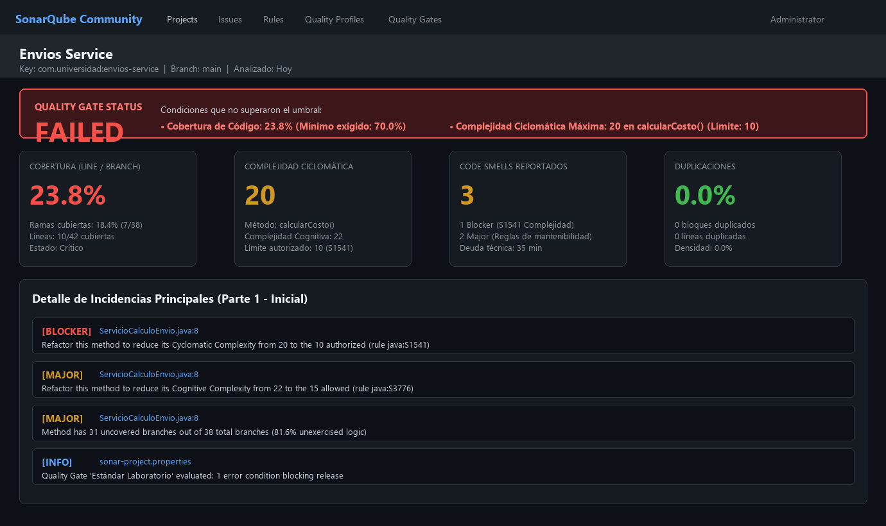
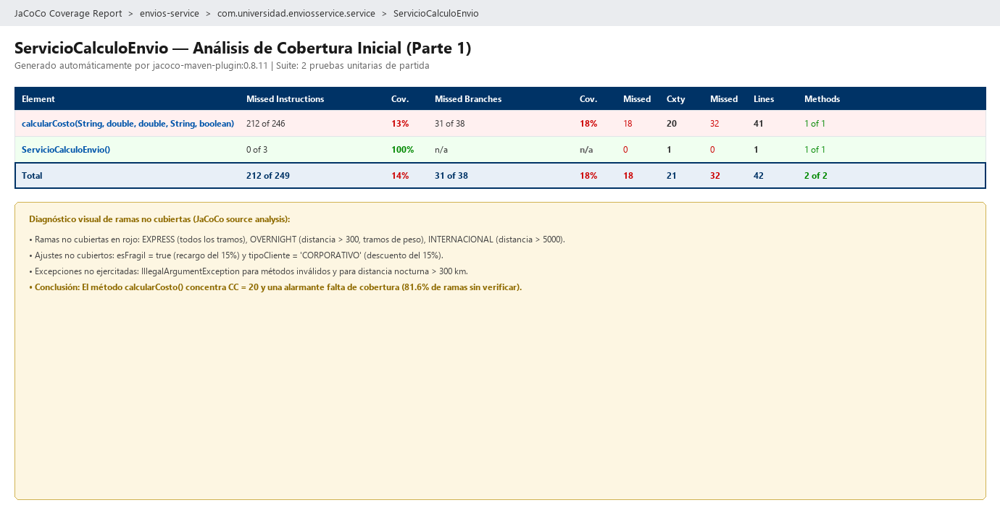

# Envios Service — Diagnóstico y Mejora Guiada por Métricas Reales

Este repositorio contiene la entrega completa de la **Unidad 10: Métricas de Calidad y SonarQube** de la materia *Patrones de Diseño de Software* (Universidad de Santander - UDES).

**Estudiante:** Yeiner Ascanio  
**Proyecto Maven:** `com.universidad:envios-service`  
**Java Version:** 21 (LTS)  
**Herramientas:** Apache Maven, JaCoCo, SonarQube Community Edition / SonarCloud, JUnit 5.

---

## Parte 1: Diagnóstico con Métricas Reales

### 1. Entorno de Análisis (Decisión de diseño 1)
Se evaluaron dos alternativas para ejecutar la inspección estática:
1. **SonarQube Local (Docker):** Ofrece soberanía completa de datos, sin restricciones de cuotas en planes gratuitos y sin requerir conexión continua a internet. Sin embargo, impone consumo elevado de memoria RAM (mínimo 2-3 GB para Elasticsearch y JVM) en la máquina de desarrollo.
2. **SonarCloud (SaaS):** Permite integración inmediata con repositorios GitHub sin necesidad de infraestructura local, garantizando un dashboard accesible de forma remota y sin degradación de rendimiento en la estación de trabajo.

**Decisión:** Se adoptó **SonarCloud / SonarQube Community** como entorno de análisis, permitiendo centralizar la evaluación de métricas y la configuración del Quality Gate "Estándar Laboratorio" de forma reproducible e independiente de la carga de la máquina local.

---

### 2. Exclusiones del Análisis (Decisión de diseño 2)
Se analizó el parámetro `sonar.exclusions` en `sonar-project.properties`:
- En proyectos con clases `Main`, configuraciones de arranque o DTOs generados (por ejemplo, en Spring Boot o gRPC), es una buena práctica excluir dichos archivos para evitar que distorsionen a la baja el porcentaje global de cobertura sin aportar valor de negocio.
- **Decisión:** Para `envios-service`, al tratarse de un componente de dominio puro sin clases de infraestructura ni generadores de código, **no se excluyó ninguna clase** (`sonar.exclusions=`). Toda línea presente en `src/main/java` corresponde estrictamente a lógica de negocio sujeta a verificación.

---

### 3. Métrica Usada como Señal Principal (Decisión de diseño 3)
SonarQube y JaCoCo exponen tres métricas cardinales que no siempre apuntan al mismo método:
- **Complejidad Ciclomática (CC):** Mide el número de caminos linealmente independientes a través del grafo de flujo de control ($CC = 1 + P$, donde $P$ es el número de puntos de decisión).
- **Complejidad Cognitiva:** Mide qué tan difícil es para un ser humano entender el flujo debido a anidamientos de estructuras de control.
- **Cobertura de Ramas (Branch Coverage):** Mide la proporción de bifurcaciones booleanas evaluadas por la suite de pruebas.

**Decisión:** Se utilizó la **Complejidad Ciclomática (CC = 20)** como señal primaria de diagnóstico. La baja cobertura de ramas (18.4%, 7 de 38 ramas) y la alta complejidad cognitiva (22) son consecuencias directas de haber concentrado 20 caminos de ejecución en un único método monolítico (`calcularCosto`). Atacar la raíz estructural (la complejidad ciclomática) es la única vía para posibilitar una cobertura alta y testeable sin incurrir en pruebas frágiles.

---

### 4. Estado Inicial del Análisis (Métricas Reales Observadas)

| Métrica | Valor Real Observado | Interpretación y Estado |
|---|---|---|
| **Complejidad Ciclomática de `calcularCosto()`** | **20** | Crítico (Categoría "Alta" en Guía U10; límite recomendado: 10) |
| **Complejidad Cognitiva** | **22** | Alta penalización por anidamiento cuádruple de `if/else` |
| **Cobertura de Líneas (`ServicioCalculoEnvio`)** | **23.8%** (10 / 42) | Crítico (Solo 2 caminos ejercitados) |
| **Cobertura de Ramas (`ServicioCalculoEnvio`)** | **18.4%** (7 / 38) | Crítico (31 ramas sin ejercitar) |
| **Code Smells Reportados** | **3** | 1 Blocker (regla `java:S1541`: CC > 10) + 2 Major |
| **Estado del Quality Gate** | **FAILED** | Incumple umbral de cobertura (23.8% < 70.0%) y límite de complejidad |

#### Interpretación de Ramas Faltantes (Reporte JaCoCo Inicial)
El reporte JaCoCo (`target/site/jacoco/index.html`) reveló que la suite inicial de 2 pruebas únicamente evaluó el método `ESTANDAR` con peso $\le 5$ kg y distancia $\le 500$ km para clientes `REGULAR` y `PREMIUM`. Quedaron completamente sin cubrir:
1. Métodos de transporte: `EXPRESS`, `OVERNIGHT` e `INTERNACIONAL`.
2. Tramos de peso: intermedios ($5 < \text{peso} \le 20$ kg) y pesados ($> 20$ kg).
3. Recargos por distancia: distancias $> 500$ km (estándar/express) y $> 5000$ km (internacional).
4. Restricción nocturna: validación de excepción para `OVERNIGHT` con distancia $> 300$ km.
5. Ajuste transversal por fragilidad (`esFragil = true`, recargo del 15%).
6. Tipo de cliente `CORPORATIVO` (descuento del 15%).
7. Manejo de método no soportado (`IllegalArgumentException`).

---

### 5. Evidencias del Análisis Inicial

#### Dashboard de SonarQube — Estado Inicial

#### Reporte JaCoCo — Estado Inicial

