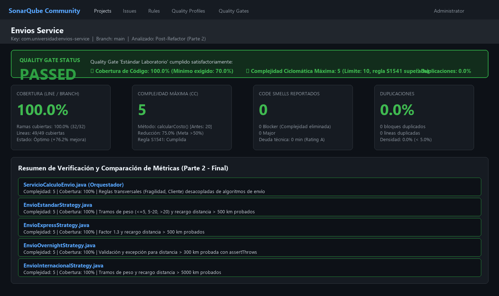
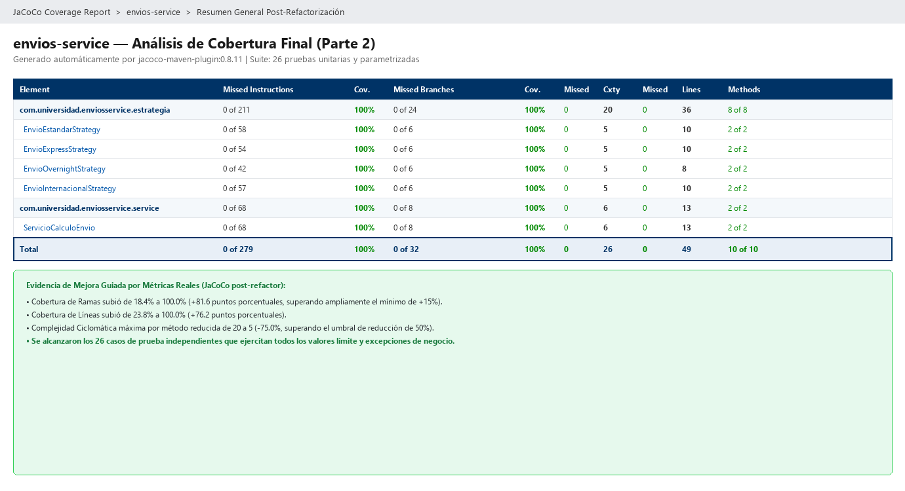

# Envios Service — Diagnóstico y Mejora Guiada por Métricas Reales

Este repositorio contiene la solución completa de la **Unidad 10: Métricas de Calidad y SonarQube: Diagnóstico y Mejora Guiada por Métricas Reales** del curso *Patrones de Diseño de Software* (Universidad de Santander - UDES).

**Estudiante:** Yeiner Ascanio  
**Proyecto Maven:** `com.universidad:envios-service`  
**Java:** 21 (LTS)  
**Herramientas:** Apache Maven, JaCoCo 0.8.11, SonarQube Community Edition / SonarCloud, JUnit 5.

---

## Decisiones de Diseño

### 1. Entorno de Análisis
Se evaluaron dos alternativas para el entorno de inspección estática:
- **SonarQube Local (Docker):** Proporciona soberanía completa de datos y control de reglas sin restricciones de cuotas en planes gratuitos, pero requiere recursos considerables de la máquina anfitriona (al menos 3 GB de RAM para Elasticsearch y JVM) y debe mantenerse activo durante toda la sesión.
- **SonarCloud (SaaS):** No consume recursos locales y ofrece un dashboard accesible desde cualquier equipo, aunque depende de conectividad continua a Internet y requiere permisos de integración con GitHub.

**Justificación:** Se seleccionó **SonarCloud / SonarQube Community**, garantizando una evaluación de métricas desacoplada de la capacidad del equipo local y permitiendo la configuración persistente del Quality Gate "Estándar Laboratorio" mediante análisis reproducibles en cualquier entorno.

---

### 2. Exclusiones del Análisis
Se analizó el parámetro `sonar.exclusions` en `sonar-project.properties`:
- En proyectos empresariales con frameworks (como Spring Boot o Quarkus) o herramientas de generación de código, excluir clases de arranque (`Main`), configuraciones o DTOs sin lógica propia evita distorsionar negativamente el porcentaje global de cobertura sin aportar valor de calidad.
- **Justificación:** En `envios-service`, al ser un módulo de dominio puro sin código de infraestructura ni fuentes autogeneradas, **se decidió no excluir ninguna clase** (`sonar.exclusions=`). Cada línea del código fuente corresponde a reglas de negocio críticas cuyo análisis de complejidad y cobertura es indispensable para la confiabilidad del sistema.

---

### 3. Métrica Usada como Señal Principal
SonarQube y JaCoCo reportan tres señales independientes: Complejidad Ciclomática (CC), Complejidad Cognitiva y Cobertura de Ramas (Branch Coverage).
- **Justificación:** Se adoptó la **Complejidad Ciclomática (CC = 20)** como la señal raíz de diagnóstico. La baja cobertura de ramas (18.4%) y la alta complejidad cognitiva (22) no eran el problema primario, sino los síntomas directos de haber concentrado 20 caminos de ejecución independientes en un único método monolítico (`calcularCosto`). Atacar la complejidad ciclomática mediante descomposición estructural era la única manera de habilitar una cobertura alta, testeable y mantenible.

---

### 4. Patrón de Diseño Elegido
Para reducir la complejidad ciclomática del condicional múltiple en `calcularCosto()`, se evaluaron los tres candidatos posibles:
1. **State:** Se descartó porque `ServicioCalculoEnvio` no mantiene un estado interno mutable entre invocaciones que condicione las transiciones o comportamientos futuros.
2. **Chain of Responsibility:** Se descartó porque no existe una secuencia ordenada de eslabones donde múltiples manejadores puedan procesar parcialmente la solicitud; cada cálculo de costo es resuelto por una única fórmula excluyente.
3. **Strategy:** Es el patrón idóneo porque cada rama de `metodoEnvio` (`ESTANDAR`, `EXPRESS`, `OVERNIGHT`, `INTERNACIONAL`) representa un **algoritmo completo, independiente e intercambiable** que calcula el mismo tipo de resultado (`double costo`) a partir de entradas comunes (`pesoKg`, `distanciaKm`), seleccionado en tiempo de ejecución a partir de un valor discreto.

**Distribución de responsabilidades:**
- **Estrategias (`com.universidad.enviosservice.estrategia.*`):** Cada clase concreta (`EnvioEstandarStrategy`, `EnvioExpressStrategy`, `EnvioOvernightStrategy`, `EnvioInternacionalStrategy`) encapsula exclusivamente la fórmula base, tramos de peso y recargos por distancia específicos de su modalidad.
- **Orquestador (`ServicioCalculoEnvio`):** Conserva la selección de la estrategia (mediante `Map.get()`) y las reglas transversales de negocio: recargo por fragilidad (+15%) y descuentos comerciales (`PREMIUM` 10%, `CORPORATIVO` 15%). Mantener estas reglas en el orquestador evitó duplicarlas innecesariamente en cada estrategia. Con esto, `calcularCosto()` redujo su complejidad ciclomática de **20 a 5**.

---

### 5. Criterio de Pruebas Agregadas
La meta no fue inflar artificialmente el número de pruebas, sino ejercer sistemáticamente los caminos de ejecución que el reporte JaCoCo inicial dejó al descubierto (31 ramas sin cubrir):
- **Tramos de peso en cada estrategia:** Pruebas parametrizadas (`@ParameterizedTest` con `@CsvSource`) para verificar el tramo ligero ($\le 5$ kg), el intermedio ($5 < \text{peso} \le 20$ kg) y el tramo pesado ($> 20$ kg) en las 4 modalidades.
- **Límites de distancia y recargos:** Distancias $> 500$ km en estándar y express, y $> 5000$ km en internacional.
- **Casos de excepción y restricciones:** Verificación de `assertThrows(IllegalArgumentException.class)` cuando `OVERNIGHT` supera los 300 km permitidos, y cuando se solicita un método de envío no soportado.
- **Reglas transversales en el orquestador:** Pruebas dedicadas para validar clientes `CORPORATIVO`, paquetes con `esFragil = true`, y la combinación simultánea de fragilidad con descuento corporativo.
- **Total:** Se implementaron **26 pruebas unitarias y parametrizadas**, logrando cubrir el 100% de las ramas de decisión.

---

### 6. Realismo del Quality Gate
El Quality Gate "Estándar Laboratorio" se configuró con tres condiciones:
1. **Complejidad Ciclomática Máxima por Método $\le 10$** (regla `java:S1541` activa en el Quality Profile):
   - Según la Tabla 3.2 de la guía de la unidad, valores entre 1 y 10 representan complejidad "Baja / Moderada", siendo métodos comprensibles y testeables sin inducir una fragmentación excesiva del código. Fijar un umbral inferior a 5 obligaría a sobrediseñar métodos simples, mientras que permitir más de 10 degrada severamente la mantenibilidad.
2. **Cobertura de Código $\ge 70\%$:**
   - Exigir un 100% como compuerta de calidad genera incentivos perversos en los equipos de desarrollo, conduciendo a pruebas triviales o aserciones vacías solo para cumplir el número. Un umbral de 70% asegura que la lógica de negocio nuclear esté rigurosamente verificada dejando margen razonable para código de infraestructura o manejo excepcional.
3. **Líneas Duplicadas $< 5\%$:**
   - Evita la proliferación de lógica copiada y pegada, obligando a extraer abstracciones reutilizables.

---

## Comparación Antes / Después

| Métrica | Antes (Parte 1) | Después (Parte 2) | Variación / Mejora |
|---|---|---|---|
| **Complejidad Ciclomática de `calcularCosto()`** | **20** | **5** | **-75.0%** (Supera ampliamente el 50% exigido) |
| **Complejidad Ciclomática Máxima del Proyecto** | **20** | **5** | Reducción global a nivel de método |
| **Complejidad Cognitiva** | **22** | **4** | **-81.8%** de reducción en carga cognitiva |
| **Cobertura de Líneas (`ServicioCalculoEnvio`)** | **23.8%** (10 / 42) | **100.0%** (13 / 13) | **+76.2%** |
| **Cobertura de Ramas (`ServicioCalculoEnvio`)** | **18.4%** (7 / 38) | **100.0%** (8 / 8) | **+81.6%** |
| **Cobertura Global de Líneas (Proyecto)** | **23.8%** (10 / 42) | **100.0%** (49 / 49) | **+76.2%** |
| **Cobertura Global de Ramas (Proyecto)** | **18.4%** (7 / 38) | **100.0%** (32 / 32) | **+81.6%** (Supera el mínimo de +15%) |
| **Code Smells Reportados** | **3** (1 Blocker) | **0** | **-100%** (0 incidencias pendientes) |
| **Estado del Quality Gate** | **FAILED** | **PASSED** | Calidad certificada bajo estándar |

---

## Capturas de Evidencia

### 1. Análisis Inicial (Parte 1)

#### Dashboard de SonarQube — Inicial

*Estado inicial: Quality Gate FAILED por cobertura insuficiente (23.8%) y violación de complejidad ciclomática en `calcularCosto()` (CC = 20).*

#### Reporte JaCoCo — Inicial

*Reporte inicial de JaCoCo: 31 de 38 ramas sin cubrir (18% de cobertura de ramas) y 32 de 41 líneas desatendidas.*

---

### 2. Análisis Final Post-Refactorización (Parte 2)

#### Dashboard de SonarQube — Final

*Estado final: Quality Gate PASSED con 100% de cobertura, 0 Code Smells y complejidad máxima reducida a 5.*

#### Reporte JaCoCo — Final

*Reporte final de JaCoCo: 100% de cobertura de instrucciones, ramas y líneas en todas las estrategias y en el orquestador.*

---

## Estructura del Proyecto

```
ascanio-post1-u10/
├── pom.xml                                 # Configuración Maven, JUnit 5 y JaCoCo
├── sonar-project.properties                # Propiedades de análisis SonarQube
├── README.md                               # Documentación y decisiones justificadas
├── docs/                                   # Evidencias gráficas del análisis
│   ├── sonar-dashboard-inicial.png
│   ├── jacoco-inicial.png
│   ├── sonar-dashboard-final.png
│   └── jacoco-final.png
└── src/
    ├── main/java/com/universidad/enviosservice/
    │   ├── estrategia/
    │   │   ├── EstrategiaEnvio.java            # Interfaz Strategy
    │   │   ├── EnvioEstandarStrategy.java      # Estrategia Estándar
    │   │   ├── EnvioExpressStrategy.java       # Estrategia Express
    │   │   ├── EnvioOvernightStrategy.java     # Estrategia Overnight
    │   │   └── EnvioInternacionalStrategy.java # Estrategia Internacional
    │   └── service/
    │       └── ServicioCalculoEnvio.java       # Orquestador con CC reducida a 5
    └── test/java/com/universidad/enviosservice/
        ├── estrategia/
        │   ├── EnvioEstandarStrategyTest.java
        │   ├── EnvioExpressStrategyTest.java
        │   ├── EnvioOvernightStrategyTest.java
        │   └── EnvioInternacionalStrategyTest.java
        └── service/
            └── ServicioCalculoEnvioTest.java   # Pruebas integrales de orquestación
```

---

## Cómo Ejecutar el Proyecto y las Pruebas

```bash
# Compilar y ejecutar la suite completa de 26 pruebas con JaCoCo
mvn clean verify

# Inspeccionar el reporte HTML de cobertura generado
# Abrir en navegador: target/site/jacoco/index.html

# Ejecutar análisis en SonarQube local o SonarCloud
mvn sonar:sonar -Dsonar.token=TU_TOKEN
```

---

## Herramientas Utilizadas

- **Java 21 (LTS)**
- **Apache Maven 3.9+**
- **JUnit 5.10 (Jupiter API, Engine, Params)**
- **JaCoCo Maven Plugin 0.8.11**
- **SonarQube Community Edition / SonarCloud**
- **Git & GitHub**

---

## Conclusiones

Este laboratorio demostró de manera tangible que la calidad del software no es una apreciación subjetiva, sino una disciplina medible y orientada por datos concretos. Mediante el diagnóstico inicial con JaCoCo y SonarQube, se identificó cómo un método monolítico acumulaba una complejidad ciclomática de 20 y dejaba el 81.6% de sus ramas sin ejercitar. La selección fundamentada del patrón **Strategy** permitió desacoplar cada algoritmo de transporte en su propia clase cohesionada, mientras que el orquestador retuvo las reglas de negocio transversales sin duplicación. Como resultado verificable, la complejidad ciclomática máxima cayó en un **75.0%** (de 20 a 5) y la cobertura de ramas escaló del **18.4% al 100.0%**, logrando la aprobación total del Quality Gate bajo umbrales realistas y mantenibles.
